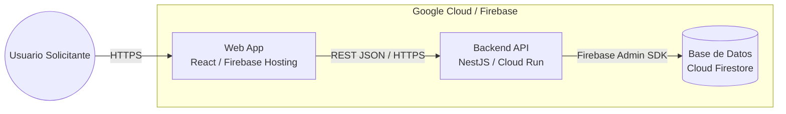
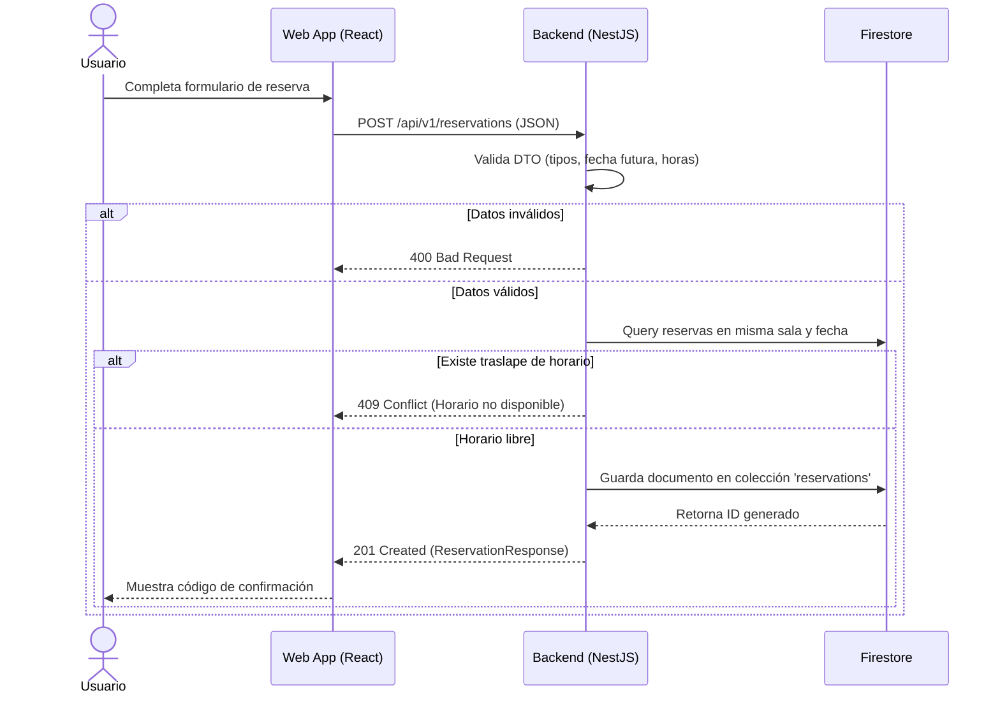

# 02 - Arquitectura del Sistema

## 1. Stack Tecnológico Cerrado

- **Frontend:** React + TypeScript + Tailwind CSS (Desplegado en Firebase Hosting).
- **Backend API:** Node.js 20 + NestJS + TypeScript (Desplegado en Google Cloud Run).
- **Base de Datos:** Google Cloud Firestore (Modo Nativo).
- **Validación:** `class-validator` y `class-transformer` en backend; `zod` en frontend.

## 2. Estructura de Carpetas Obligatoria (Backend)

```text
backend/
├── src/
│   ├── common/          # Filtros de excepciones e interceptores globales
│   ├── config/          # Variables de entorno y cliente de Firestore
│   ├── modules/
│   │   ├── rooms/       # Módulo de consulta de salas
│   │   └── reservations/# Módulo de creación y consulta de reservas
│   ├── app.module.ts
│   └── main.ts
└── test/
```

_(No crear carpetas genéricas como `/utils`, `/helpers` o `/misc`)._

## 3. Diagrama de Contenedores (C4 - Nivel C2)



## 4. Diagrama de Secuencia: Crear Reserva (Flujo Principal)


